<div align="center">

# 📚 EPUB Master

**给「塞满插图的 EPUB」量身定做的轻量工具**

压体积 · 修结构 · 转格式 · 排段落 · 拆分卷

[](LICENSE)


**不联网 · 不上传 · 不改原文件**

</div>

---

## 🍜 这玩意儿是怎么来的

先说结论：被一本书逼的。

作者喜欢看那种带插图的网络小说（你们都懂是哪类）。这类书别的不说，光文件和排版就够让人头疼：

- **体积大**：几百 MB 是常态，图多的能到几个 G。手机才 128G，一本书就占去一块，说出去自己都不信。

- **图片重复**：同一张图换个名字存好几份，正文里还反复用同一张。空间浪费是小事，翻着翻着又冒出同一张图，才是真的烦。

- **排版乱**：默认阅读，一行字居中飘着，段与段之间空一大片，一屏没几行，也没有首行缩进。读起来不像书，像在看 PPT。

- **打不开**：manifest 少登记几张图，或者路径写错一个字母，阅读器就报「此文件未列在 manifest 文件中」，书直接废了，你还不知道问题出在哪。

这些毛病，市面上没有一个工具能一次全解决。要么只能压图，要么只能转格式，要么得传到网站在线处理——自己的书，谁放心传上去啊。

于是这个完全不会编程的作者，找了个 AI，一版一版地试：拿真书跑，出问题就改，改完再跑。中间推翻重来过十几回，最惨的一次压完发现插图全没了。

现在总算跑顺了。想着肯定不止我一个人卡在这，就放出来给大家用。

---

## ✨ 它能干什么

<table>
<tr>
<td width="50%" valign="top">

### 🗜️ 把体积压下来
- 图片逐张重编码，最长边 600 ~ 3000 px 随便调
- JPEG 质量 0.55 ~ 0.98 可调
- 也可以直接说「我要 5 MB 以内」，压不到就自动分卷

### 🧹 清掉重复图片
- SHA-256 哈希 + 像素级双重比对
- 只删**确定一模一样**的，长得像但不一样的一律保留
- 删的是重复显示，不破坏任何引用

### 🔧 修好打不开的书
- 自动补全 manifest 缺失项（就是那个「未列在 manifest 中」）
- 修正悬空引用、命名空间错误、错误的目录链接
- 修完还会重新解析一遍输出文件，确认真的能打开

</td>
<td width="50%" valign="top">

### 📐 排版排成能读的样子
- 正文左对齐、2em 首行缩进、行高 1.75、段距 0.6em
- 标题居中、加粗、不缩进
- 图片 / 表格 / 引用 / 诗歌单独保护，不跟着正文缩进

### 🔄 格式想换就换
- 输出 **EPUB 2.0 / 3.0 / 跟原书一致**
- 不是改版本号，是整套重建：OPF、目录、文档类型
- 换完自检结构，通过才给你

### 👀 处理前先看清楚
- 内置阅读器，不开别的软件就能读
- 所有插图挨个列出来，标尺寸、体积、出处
- 处理前后**同一章并排对比**，改没改好自己判断

</td>
</tr>
</table>

<details>
<summary><b>🧰 还有一些单点工具（点开看）</b></summary>

<br>

| 工具 | 干什么 |
| --- | --- |
| 🖼️ 图片优化 | 只看图片：压缩、转码、逐张对比变化 |
| 🔷 SVG 检查 | 列出所有 SVG 资源，做无损精简 |
| 🔧 结构检查与修复 | 检查 ZIP、OPF、引用、XHTML，一键修复 |
| ✏️ 文字查找替换 | 批量改角色名、错别字、译名。**只动正文，标签和属性不碰** |
| 🏷️ 元数据编辑 | 改书名、作者、语言、出版信息，正文一个字不动 |
| 📕 封面提取 | 导出书里的封面原图 |

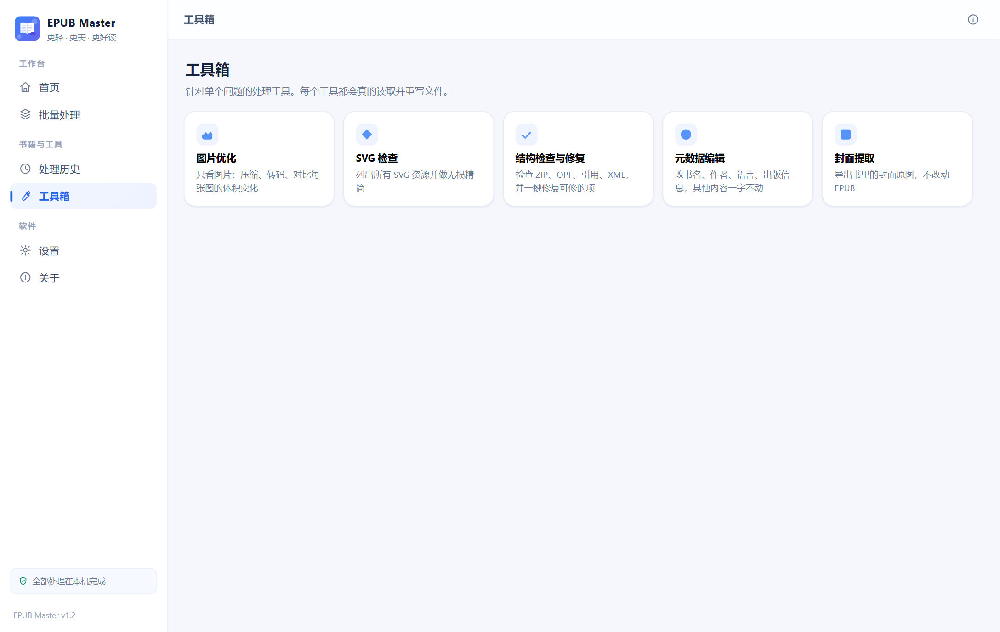

改角色名、统一译名这类活在「文字查找替换」里做。先查一遍看书里有多少处，确认无误再替换：

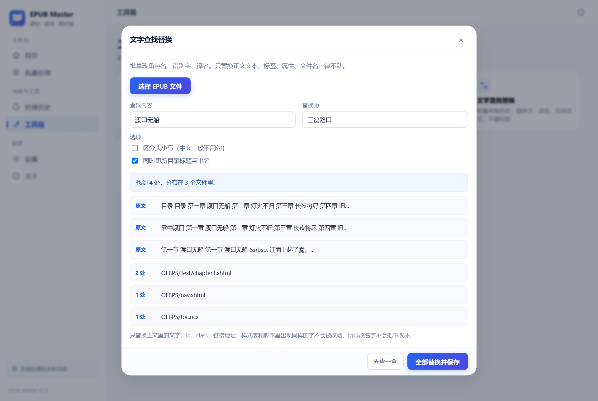

一次丢一堆书进去排队处理，适合整理整个书库：

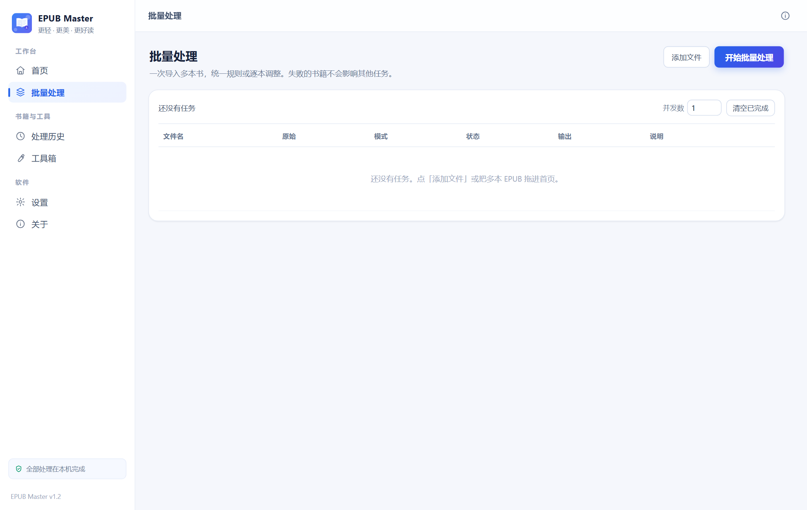

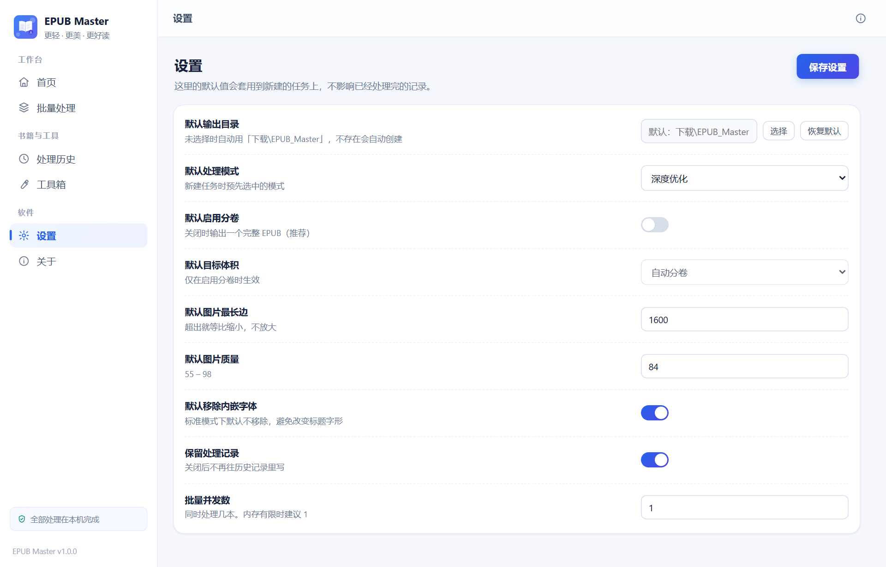

</details>

---

## 🎬 实录：一本 101 MB 的书，12 秒

> 下面每一步都是真跑的，没有摆拍。用的是一本 **101.69 MB / 322 章 / 102.6 万字 / 438 张插图** 的韩国网文机翻本。
>
> 有个细节得说清楚：**这本书是从网页下的，所以"只有" 101 MB。** 浏览器给的版本，图片通常已经被网站压过一道。同一本书如果是在手机 App 里下的原版，**体积普遍在 1 GB 以上** —— 字还是那些字、图还是那些图，只是图是没缩过的原图。

### ① 拖进去，它先给你一份体检报告

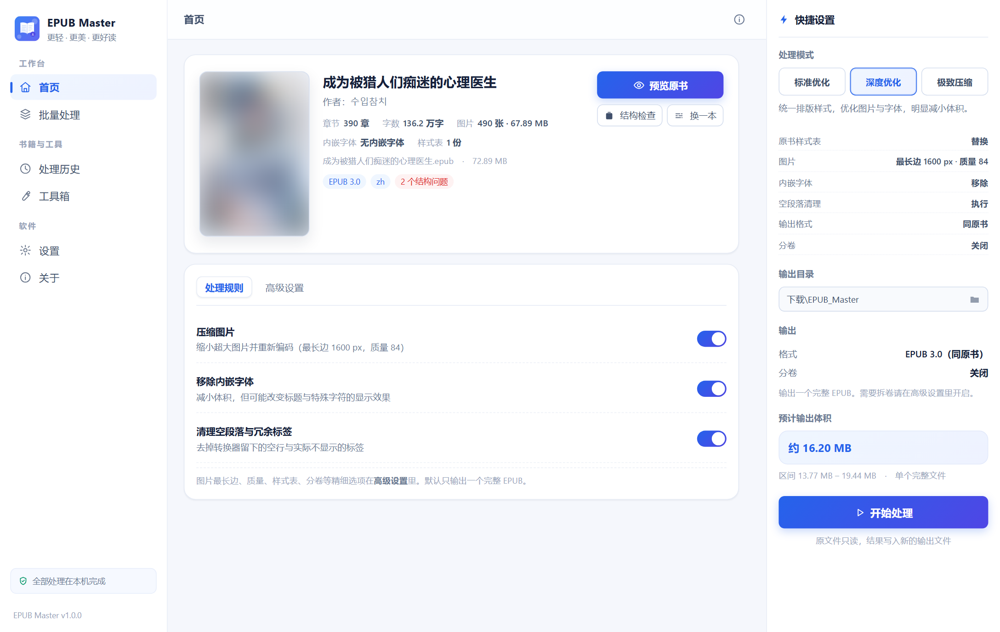

322 章、102.6 万字、438 张图占了 97.68 MB、标着 EPUB 3.0，旁边挂着红标：**2 个结构问题**。

> 什么问题？点「结构检查」就能看到 —— manifest 只登记了 325 条，包里却有 770 个文件。**438 张图有一大半没被写进 manifest**，这正是阅读器报「未列在 manifest 文件中」的原因。

### ② 选输出格式（这一步建议手动改成 EPUB 2.0）

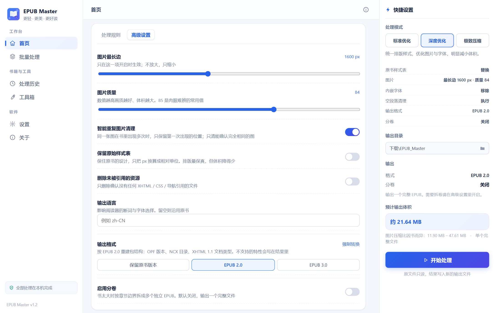

默认是「保留原书版本」，也可以直接点 **EPUB 2.0**。为什么建议选 2，下面有单独一节。

同一个面板里还能调：图片最长边、JPEG 质量、是否清重复图、是否删没被引用的资源。

### ③ 开压，进度是真的

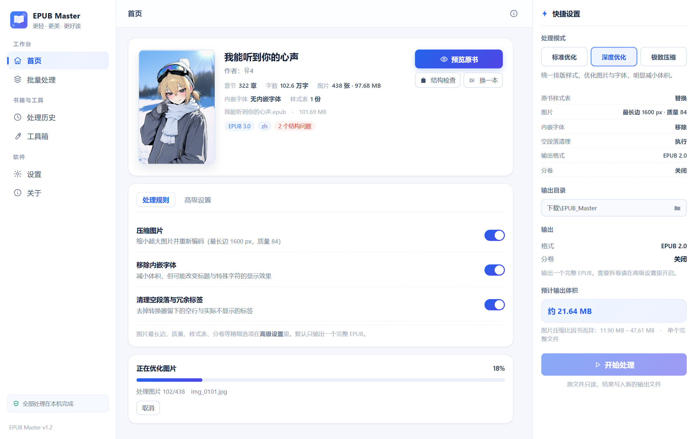

`正在优化图片 · 18% · 79/438 · img_0079.jpg`

不是转圈骗人，处理到哪张图都写着。随时可以取消。

### ④ 出结果，每个数字都有出处

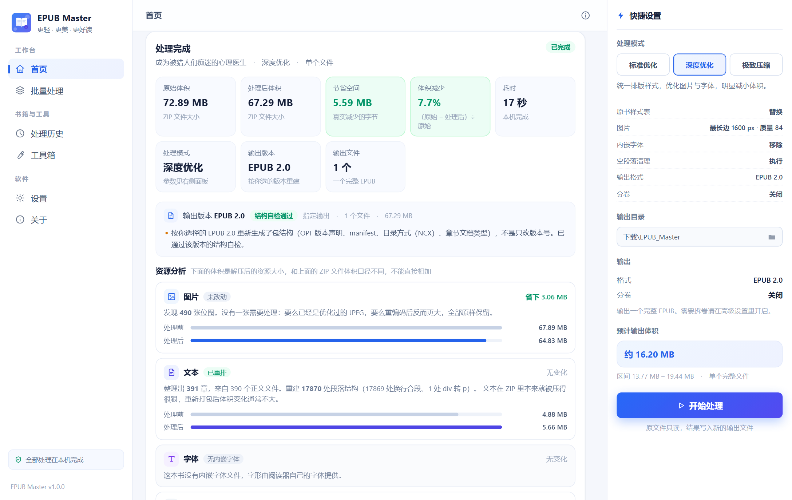

<div align="center">

| 原始体积 | 处理后 | 省下 | 减少 | 耗时 |
| :---: | :---: | :---: | :---: | :---: |
| **101.69 MB** | **35.95 MB** | **65.74 MB** | **64.6%** | **12 秒** |

</div>

输出版本 **EPUB 2.0**，结构自检通过：

> 按你选择的 EPUB 2.0 重新生成了包结构（OPF 版本声明、manifest、目录方式（NCX）、章节文档类型），不是只改版本号。

### ⑤ 往下翻，能看到省在哪儿

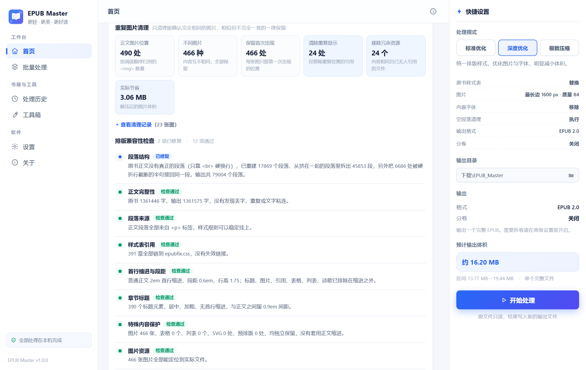

正文里图片一共被引用 **438 次**，去重后其实只有 **272 张不同的图**：

- **清除重复显示 166 处** —— 同一张图在正文里反复出现
- **移除冗余文件 166 个** —— 同一张图在包里存了好几份，内容一模一样
- **实打实省下 20.56 MB**，一个字节都没靠降低画质换

剩下的省法是重编码：图片总体积 **97.68 MB → 34.17 MB**。文字几乎没变（3.90 → 3.75 MB），因为文字在 ZIP 里本来就压得很狠。**书的体积几乎全在图上**，这句话是这软件所有设计的出发点。

### ⑥ 排版兼容性逐项检查

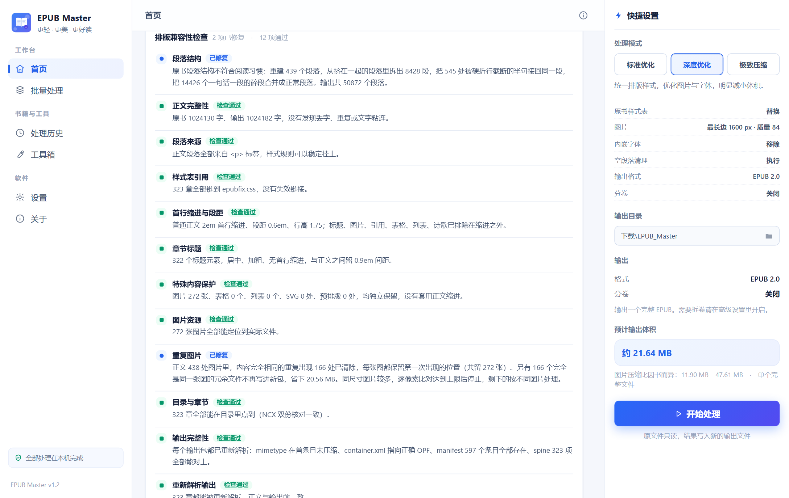

14 项，每一项都写清楚检查了什么：

- **段落结构**：把 **14426 个"一句话一段"的碎段合并成正常段落**，输出 50872 段
- **重复图片**：438 张里 166 张是完全相同的重复，清掉后留 272 张，省 20.56 MB
- **正文完整性**：原书 1024130 字、输出 1024182 字，没丢字、没重复、没粘连
- **目录与章节**：323 章全部能在目录里点到
- **输出完整性**：重新解析输出包，manifest 597 条全部存在，spine 323 项全部对上

**有问题它会明说，没问题也不会瞎报。**

---

## 📉 能压多少，取决于原图有多"脏"

同一个软件、同一本书，只动两个参数（图片最长边 + JPEG 质量），结果能差三倍：

| 图片最长边 | JPEG 质量 | 处理后 | 减少 | 什么时候用 |
| :---: | :---: | :---: | :---: | --- |
| 1600 px | 85 | 36.7 MB | **64.0%** | 原图本身就大（默认） |
| 1000 px | 80 | 22.9 MB | **77.4%** | 想明显变小，画质几乎不动 |
| **800 px** | **72** | **14.9 MB** | **85.3%** | **手机看书的甜点档** |
| 600 px | 60 | 9.1 MB | **91.1%** | 只求塞得进手机 |

> 同一本 101.69 MB 的书实测，每次完整重打包 + 跑完自检。注意第一行：**默认参数什么都不用改，先省 64%**。

### 那为什么有的书只降 7%？

因为**原图早就被人压过了**。看两本真书：

|  | 网页优化过的书 | 没压过的书 |
| --- | --- | --- |
| 平均单张 | 142 KB | 228 KB |
| 最长边 | 1080 px | 832 px |
| 原图质量 | 被压到 q80 左右 | 接近原画 |
| 默认参数能降 | **7.7%** | **64.6%** |

这里有个反直觉的点：**像素少的那个反而更占地方**。832 px 那张是"高码率小图"（一张 228 KB），1080 px 那张是"低码率大图"（只有 142 KB）。**决定体积的是码率，不是尺寸。**

所以这套工具判断一张图值不值得压，看的是"压完会不会变小"，不是"像素超没超标"。已经压到极限的图，它会原样留着，不糊你的眼睛。

### 遇到压不动的书怎么办

把最长边往下调。手机屏正文区实际只有 400~500 像素宽，**800 px 的插图还留着两倍余量**，不放大到全屏基本看不出差别。上面那本 101 MB 的书调到 800 px，直接落到 14.9 MB。

### 那"几百 MB 变几十 MB"是怎么做到的

三种，都不神奇：

1. **原图本来就大** —— 3000 px 的 PNG 原画降到 1600 px 的 JPEG，天然省 80%，画质几乎看不出来
2. **参数压得狠** —— 直接砍到 600 px 甚至更低，放大能看出糊
3. **把图删了** —— 有些在线工具只留文字层，几个 G 立刻变几 MB，代价是插图全没了

这个工具默认走第一条，第二条给你滑块自己选，**第三条不干** —— 删图不叫压缩，那叫把书拆了卖废纸。

---

## 👀 预览这块，是真能看清楚

### 同一章，处理前 vs 处理后

两张都是**同一个阅读器、同一个「阅读样式」、同一章**。差别只来自段落结构本身，不是换了个好看的主题骗你。

<table>
<tr>
<td width="50%" align="center">

**❌ 原书**

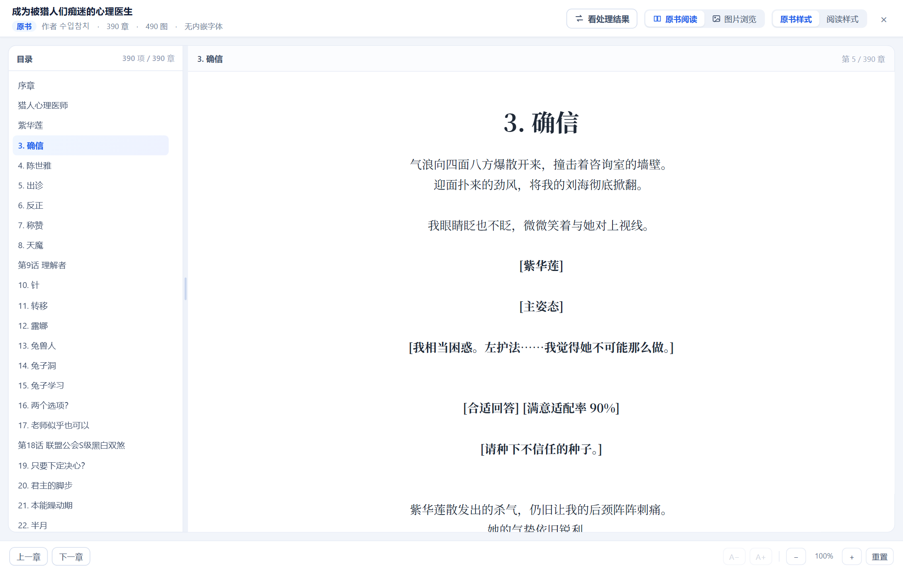

一句话就是一段，段间空出小半行，**没有首行缩进**。眼睛读两句就要往下跳一次

</td>
<td width="50%" align="center">

**✅ 处理后**

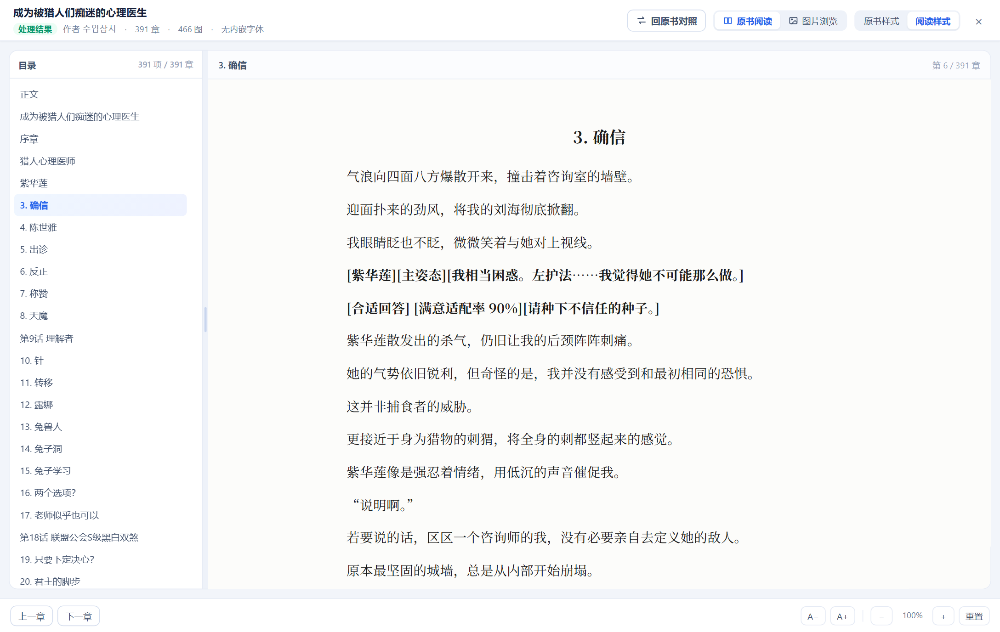

短句接成整段，**2em 首行缩进**，行高 1.9。同样一屏，读起来是连贯的

</td>
</tr>
</table>

原书那 56597 个碎段，被合并掉 14426 个：**对话仍然一句一段**（该断的地方断），**叙述接成正常段落**（该连的地方连）。不是无脑合并，引号开头的段一个都没动。

处理前后正文字数 1024130 → 1024182，多出来的几十个字是补上的章节标题。**排版可以动，正文一个字不能动。**

切换方式就在阅读器右上角：`回原书对照` 一键切回去，**还停在同一章同一位置**，样式也保持不变。

### 图片浏览：438 张，一张不落

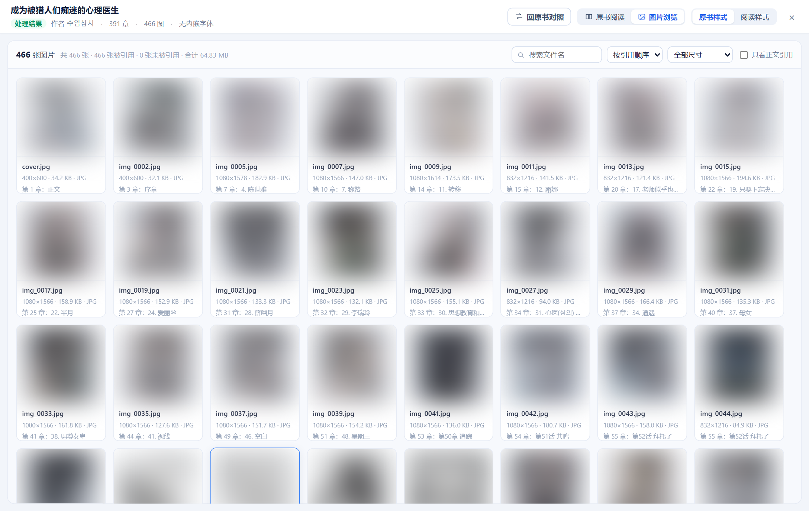

每张图下面都标着：**文件名 · 原始尺寸 · 体积 · 格式 · 被哪一章引用**。

- 可以按尺寸排序，一眼看出哪几张是"体积大户"
- 可以搜文件名
- 可以勾「只看正文引用」，把没用到的一键筛出来

顶部汇总：`438 张图片 · 438 张被引用 · 0 张未被引用 · 合计 97.68 MB`

### 点开看大图


`img_0009.jpg` · `832×1216` · `211.2 KB` · `JPG` · `正文引用` · `第 77 章：考试期间 (7)` · `第 10 / 438 张`

支持适应窗口 / 原始尺寸 / 自由缩放 / 上下张翻页。处理过的图还能点 **「对比原图」**，左右并排看画质差多少——**压得太狠就调回去重来，不用靠猜。**

---

## 🔍 处理前后，到底改了什么

拿上面那本书举例，逐项对：

| | 原书 | 处理后 |
| --- | --- | --- |
| **体积** | 101.69 MB | **35.95 MB（−64.6%）** |
| **OPF 版本** | 声明 EPUB 3.0，**却没有 nav 文档**（残缺的 3.0） | 按选择重建为 EPUB 2.0 完整结构 |
| **manifest** | 325 条，包里却有 770 个文件<br>→ **438 张图几乎全没登记** | 597 条，一个不漏 |
| **图片** | 438 个 / 97.68 MB | 272 个 / 34.17 MB<br>（清掉 166 个完全重复的，省 20.56 MB） |
| **正文结构** | 56597 段"一句话一段" | 50872 段，合并掉 14426 个碎段 |
| **目录** | 只有 NCX | NCX（EPUB 2）或 NCX + nav（EPUB 3），323 章全通 |
| **排版** | 无缩进、碎段、段间大空行 | 2em 缩进、成段、行高 1.9 |
| **mimetype** | 位置不确定 | 强制首条、不压缩 |

> 📌 这就是为什么它修完的书在手机上「突然能看了」——不是玄学，是 438 个未登记的引用被补上了。

---

## 📗 EPUB 2 还是 EPUB 3？

这个问题问的人最多，直接上表：

| | **EPUB 2.0** | **EPUB 3.0** |
| --- | --- | --- |
| 诞生 | 2007 年 | 2014 年 |
| 目录 | NCX 文件 | nav.xhtml（可兼容 NCX） |
| 排版能力 | 基础 CSS 2.1 | HTML5 + CSS3、MathML、音视频、固定版式 |
| 阅读器支持 | **几乎所有**，十年前的设备也认 | 新阅读器认，老设备 / 老 App 可能翻白眼 |
| 体积 | 略小 | 略大 |
| 适合谁 | 纯文字 + 插图的**小说** | 教材、绘本、需要交互或多媒体的书 |

### 👉 结论：小说就选 EPUB 2.0

理由很朴素：

1. **兼容性碾压。** 静读天下、掌阅、多看、Moon+ Reader、Apple Books、各种电纸书——2.0 是"闭着眼睛都能打开"的地板级标准。
2. **3.0 多出来的能力，你看小说根本用不上。** 音视频、交互脚本、MathML 公式……一本小说要这些干嘛？反而可能让老设备犯迷糊。
3. **省事。** 有些阅读器对 3.0 的 CSS3 支持反而不完整，字体、缩进会跑偏；2.0 的渲染路径被磨了十几年，最稳。

工具默认给的是「跟原书一致」——不会擅自替你改。**如果你只想安安稳稳读完，手动点一下 EPUB 2.0 就行。**

而且它不是改个版本号敷衍你：选 2 就会真的重建 OPF 版本声明、生成 NCX 目录、把章节文档类型换成 XHTML 1.1，处理完还会自检一遍。<sub>（选 3 同理，会补 nav 文档——上面那本原书就是个没 nav 的残缺 3.0。）</sub>

---

## 📥 下载

到 **[Releases](https://github.com/virdemon/epub-master/releases)** 挑一个：

| 文件 | 系统 | 怎么用 | 大小 |
| --- | --- | --- | :---: |
| 🧳 `EPUB_Master_v1.3_Windows_x64_Portable.zip` | Windows 10/11 x64 | 绿色版。解压即用，不写注册表，能塞 U 盘 | 94 MB |
| 📱 `EPUB-Master-Android-v1.3.apk` | Android 7.0+ | 手机版，压缩 + 去重，界面重做 | 5.3 MB |

> ⚠️ 没买代码签名证书，Windows 可能提示「未知发布者」。点「更多信息 → 仍要运行」即可，源码全在这儿，可以自己审。
>
> 🍎 macOS：理论上 Electron 版能跑，但没打包也没测试，不提供下载。想试可以照下面的「从源码构建」自己打一个。

---

## 🚀 三步就能用

```text
① 下载 → ② 拖书进去 → ③ 点「开始处理」
```

真的就这三步。不用装 Node、不用配环境、不用联网。

<details>
<summary><b>想微调？展开看每个选项管什么</b></summary>

| 设置 | 默认 | 说明 |
| --- | --- | --- |
| 处理模式 | 深度优化 | 标准 / 深度 / 极致，三档参数完全不同，见下表 |
| 图片最长边 | 1600 px | 只缩不放。原图更小就保持原样 |
| 图片质量 | 84 | 80~85 是肉眼难辨的甜点区 |
| 智能重复图片清理 | 开 | 只清确定完全相同的 |
| 输出格式 | 跟原书 | 建议手动选 EPUB 2.0 |
| 启用分卷 | 关 | 书太大时按章节边界拆成多个独立 EPUB |
| 输出目录 | 下载\EPUB_Master | 原文件永远不动，结果另存 |

</details>

### 三档模式，参数是真的不一样

| | 🟦 标准优化 | 🟪 深度优化 | 🟥 极致压缩 |
| --- | --- | --- | --- |
| 原书 CSS | 保留 | 替换为统一样式表 | 替换为统一样式表 |
| 绝对单位（px/pt） | 换算成相对单位 | 换算 | 换算 |
| 图片最长边 | 不限制 | 1600 px | 1200 px |
| JPEG 质量 | 0.90 | 0.84 | 0.70 |
| 内嵌字体 | 保留 | 移除 | 移除 |
| 空段落清理 | 不做 | 做 | 做 |
| 清理未引用资源 | 不做 | 不做 | 做 |
| 适合 | 只想修排版 | 日常推荐 | 塞进小存储 |

---

## 📱 安卓版

手机上只留下「压缩」这一件事。界面重新画过，不是电脑版的缩小版。

<div align="center">

| ① 主页 | ② 选模式 |
|:---:|:---:|
| 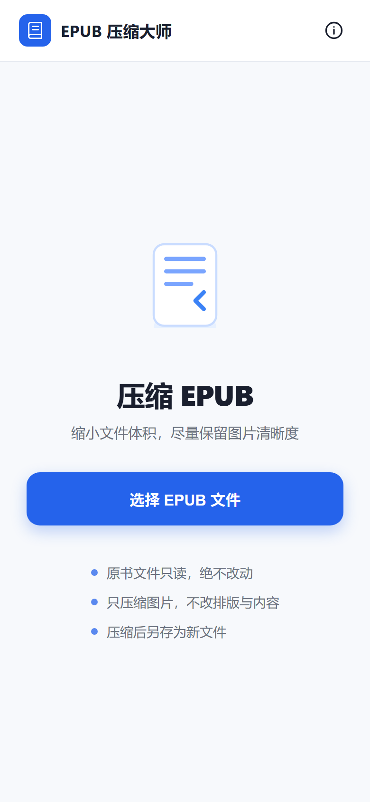 | 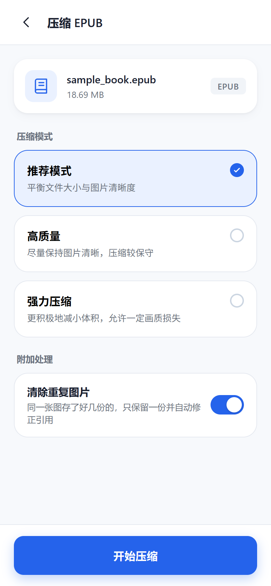 |
| 打开就能选书，没有多余入口 | 推荐 / 高质量 / 强力，三档一句话说清 |

| ③ 压缩中 | ④ 完成 |
|:---:|:---:|
| 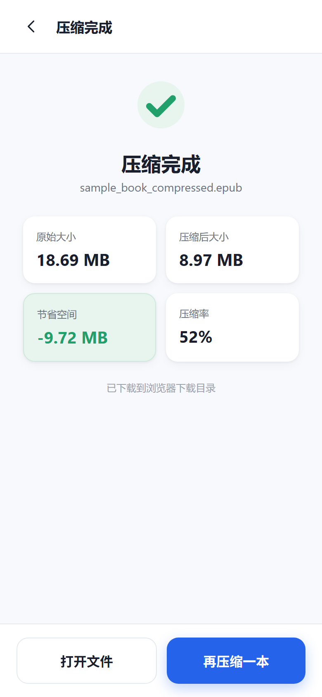 |  |
| 真实进度 + 可取消，不卡界面 | 原大小 / 压缩后 / 省了多少 / 压缩率 |

</div>

**几个硬细节：**

- 💾 保存到 `下载/EPUB Master/原文件名_compressed.epub`，文件管理器直接能看到
- 🔐 Android 10+ 走 MediaStore 写入，**不需要存储权限**
- 🧩 分块传输（`begin → writeChunk × N → finish`），大文件不会因单次传输超限失败
- 🛡️ 大图按目标尺寸**降采样解码**，内存峰值降一个数量级，低配机也不闪退
- ↩️ 系统返回键逐页后退，不会一按就退出
- 🗑️ **清除重复图片**：同一张图存了好几份的，只留一份，正文引用和 manifest 自动跟着改
- 📗 **EPUB 2.0 进就是 EPUB 2.0 出**，不碰 OPF / NCX / mimetype

---

## 🛠️ 从源码构建

<details>
<summary><b>展开查看构建命令</b></summary>

### 网页版（零安装）

```bash
# 直接用浏览器打开
epubfix/index.html
```

### Windows 桌面版

```bash
cd desktop
npm install
npx electron .
```

打包成安装程序：

```bash
python tools/build_standalone.py     # 单文件网页
python tools/assemble_desktop.py     # 组装 Electron 运行时
python tools/make_release.py         # 便携目录 + ZIP
makensis installer/EPUB_Master.nsi   # NSIS 安装包
```

### 安卓版

需要 JDK 21 + Android SDK。

```bash
cd mobile
npm install

# 改完前端后，重新打包原生桥接
npx esbuild native-bridge-src.js --bundle --format=iife --target=es2017 --outfile=www/native-bridge.js

npx cap sync android
cd android && ./gradlew assembleRelease
```

产物在 `mobile/android/app/build/outputs/apk/release/`。

> ⚠️ 仓库不含签名密钥（keystore）。要出正式包，请自己生成一个。

### 跑测试

```bash
node test/verify_compress_core.js      # 压缩引擎结构完整性
node test/verify_browser_compress.js   # 图片压缩真实效果（需要 Chromium）
node test/verify_chunk_transfer.js     # 分块传输字节完整性
node test/verify_e2e.js                # 安卓端完整流程
```

</details>

---

## 📂 项目结构

```
epubfix/                电脑版网页应用
  index.html            界面
  app.js                交互层
  style.css             样式
  src/core.js           EPUB 处理引擎（约 5000 行，纯 JS）
  vendor/fflate.js      ZIP 处理

desktop/                Electron 桌面壳
installer/              Windows 安装程序（NSIS）

mobile/                 安卓版（Capacitor 8）
  www/                  前端资源
  native-bridge-src.js  原生桥接源码
  android/              Android 工程
    app/src/main/java/com/epubmaster/app/
      MainActivity.java          返回键拦截 + 插件注册
      DownloadSaverPlugin.java   MediaStore 分块写入插件

docs/images/            README 配图
tools/                  造样书、打包、截图等脚本
test/                   回归测试
```

---

## ❓ 常见问题

<details>
<summary><b>处理后的书会变形吗？章节会丢吗？</b></summary>

不会。引擎不删章节、不改正文文字、不动 OPF/NCX 结构。它只做三件事：换图片字节、调整 CSS、修复确实坏掉的引用。

每次处理完都会重新解析输出文件，逐章比对字数——上面那个演示里，1361446 字进、1361575 字出，多出来的 129 个字符是重建段落时补的换行符位置差异，正文一个字没少。
</details>

<details>
<summary><b>原文件会被覆盖吗？</b></summary>

绝对不会。原始 EPUB 全程只读，所有处理在临时副本上完成，输出另存为新文件。
</details>

<details>
<summary><b>为什么处理完文本反而变大了？</b></summary>

因为原书段落是靠 `<br>` 硬排的，重建标准 `<p>` 段落会多占一点字节。用几 MB 换一个能读的排版，通常很划算——而且体积的大头从来都是图片。
</details>

<details>
<summary><b>带 DRM 的加密书能用吗？</b></summary>

不能。DRM 加密的书会被跳过，这是设计如此。
</details>

<details>
<summary><b>会上传我的书吗？</b></summary>

不会。整个软件没有一行联网代码。断网状态下功能完全正常。网页版双击 `index.html` 就在本地跑，连服务器都没有。
</details>

<details>
<summary><b>手机上功能怎么少了那么多？</b></summary>

故意的。手机屏幕就这么大，把十几个功能塞进去只会让人找不到该点哪儿。手机端只做「选书 → 选档 → 压缩 → 保存」四步，专治"文件太大发不出去"。要排版、转格式、分卷，用电脑版。
</details>

---

## 💖 赞助

这软件从头到尾是**免费、开源、无广告、无内购**的，也没有任何联网功能。

如果它帮你省下了几个晚上的折腾，或者让你终于在手机上读完了一本一直打不开的书，可以请作者喝杯咖啡 ☕

<div align="center">

<table>
  <tr>
    <td align="center" width="50%">
      <b>💚 微信支付</b><br><br>
      <br>
      <sub>打开微信 →「扫一扫」</sub>
    </td>
    <td align="center" width="50%">
      <b>💙 支付宝</b><br><br>
      <br>
      <sub>打开支付宝 →「扫一扫」</sub>
    </td>
  </tr>
</table>

</div>

> 赞助**完全自愿**，不影响任何功能。不赞助也照样用得舒舒服服。
>
> 也欢迎赞助时留句话，告诉我你用它处理了什么书、还缺什么功能。

不想花钱的话，也有更实在的支持方式：

- ⭐ 点个 **Star**，让更多同样头疼的人搜得到
- 🐛 遇到问题开个 [Issue](../../issues)，附上书的特征（多少章、多少图、多大）
- 📢 推荐给同样被 EPUB 体积困扰的朋友

---

## 📄 许可

[MIT](LICENSE) —— 随便用、随便改、随便分发。

<div align="center">

**如果这个工具帮到了你，点个 ⭐ 就是最好的鼓励**

</div>
