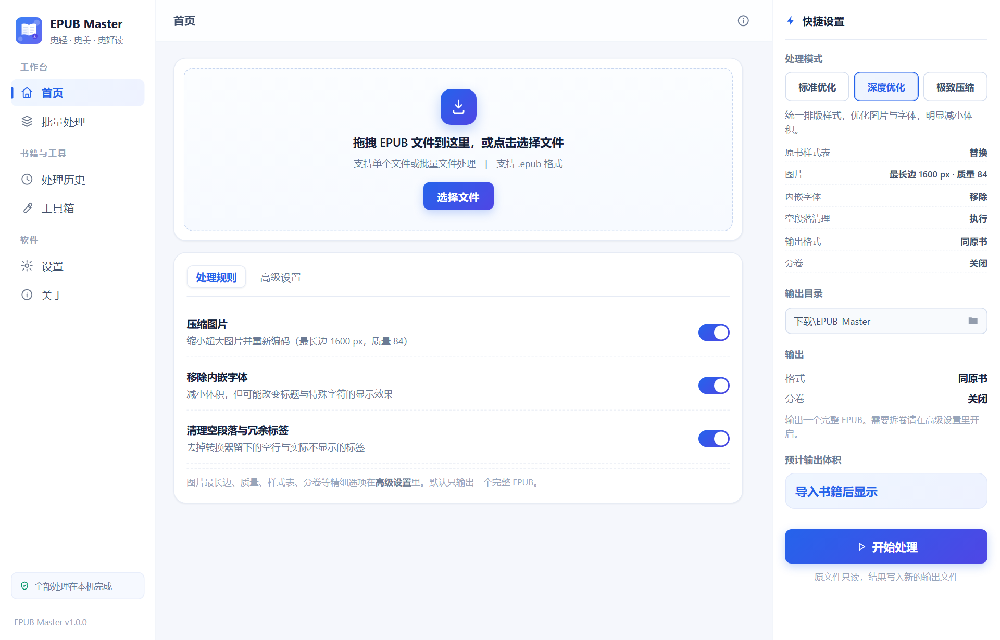
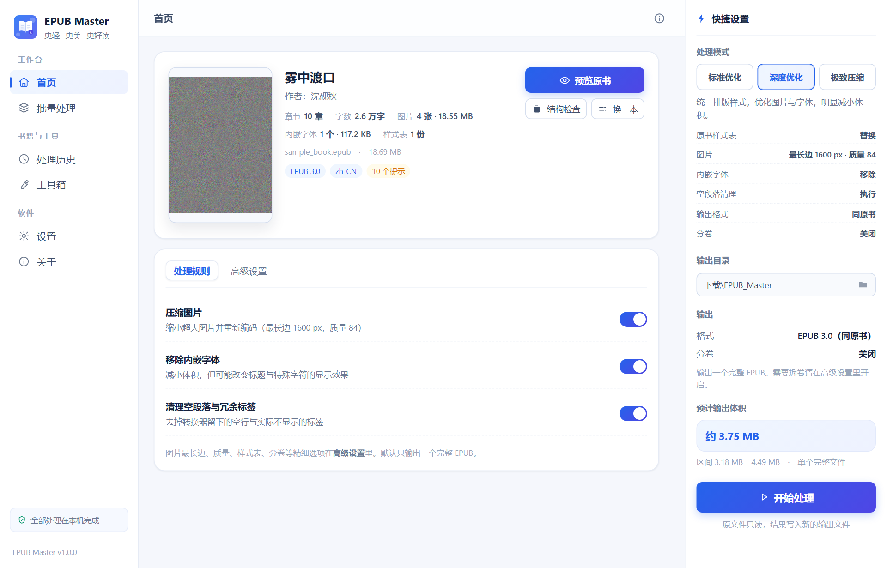
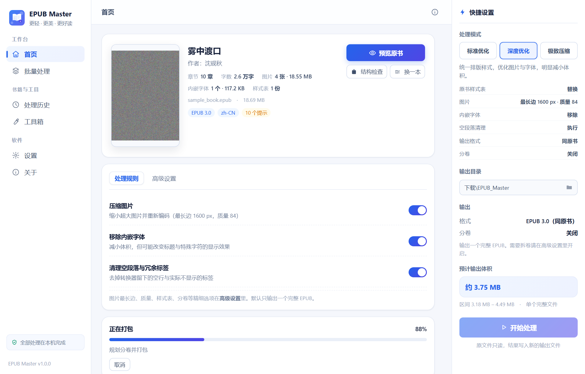
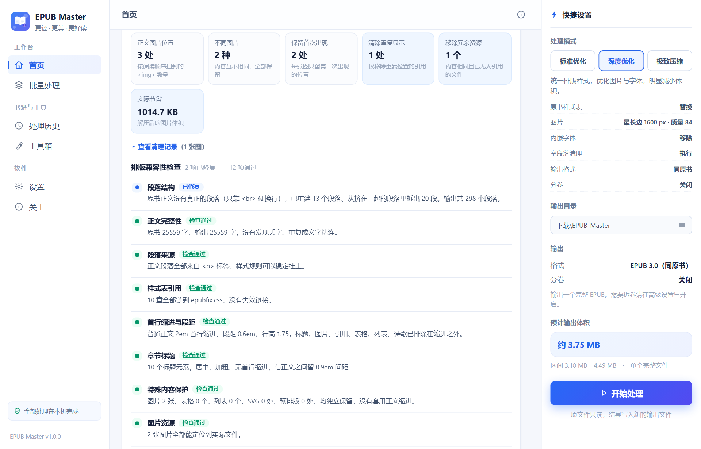
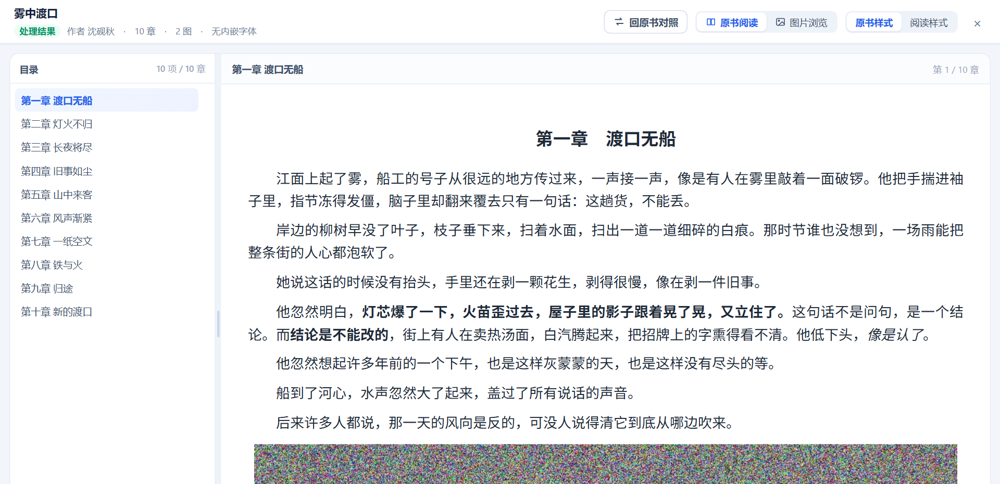
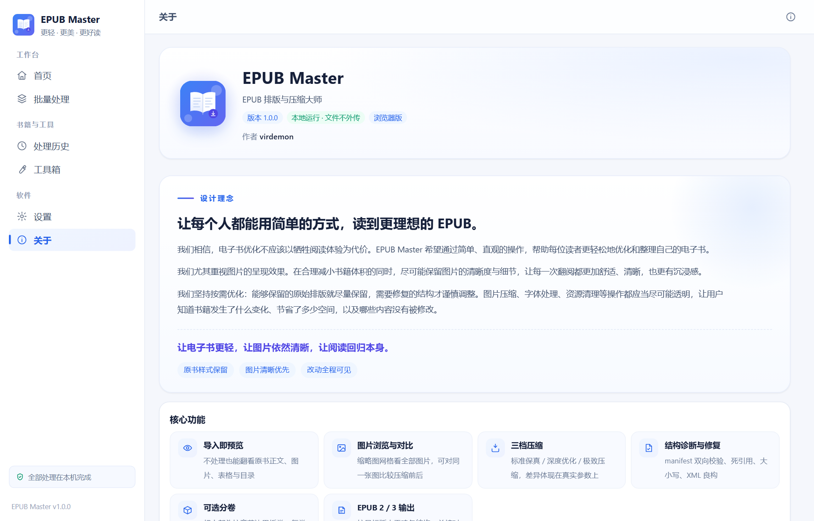

<div align="center">

# 📚 EPUB Master

**专为「一本塞满图片的 EPUB」打造的本地轻量化工具**

压缩体积 · 整理排版 · 修复结构 · 转换格式 · 按章分卷

[](LICENSE)


**文件不出本机 · 不联网 · 不上传 · 原始文件永不修改**

</div>

---

## 💡 这东西是怎么来的

说实话，这软件一开始不是奔着开源去的，是为了解决一个很私人的麻烦。

作者喜欢从**韩文机翻站**淘插图本小说。这类书有个共同的毛病：

- 📦 一本动辄 **几十到上百 MB**，塞满了整页整页的插图
- 🖼️ 图片没压过，分辨率虚高，手机翻一页卡一下
- 🧱 EPUB 结构乱七八糟，`manifest` 缺项、路径写错，**手机阅读器直接打不开**
- 📐 排版按网页来的，行距巨大、左右留白能跑马，一页看不到几个字

想看插图，又不想被文件大小和格式折腾——市面上没有能一次解决的工具。

于是这个**完全不懂编程**的作者，拉着 AI 一点一点把它做了出来。中间来来回回改了十几版，每改一次就拿真书去试，卡住了就再改。

现在功能终于跑顺了，作者觉得应该分享出来：**如果你也在为同样的事头疼，那它大概也能帮到你。**

---

## ✨ 它能做什么

<table>
<tr>
<td width="50%" valign="top">

### 🗜️ 压到能装进手机
- 图片逐张重编码，最大边可压到 1200px
- JPEG 质量 0.70 ~ 0.92 可调
- 实测一本 **18.69 MB** 的书 → **8.97 MB**，省 **52%**

### 🧹 删掉重复图片
- SHA-256 哈希 + 像素级双重比对
- 只删「确定相同」的，**拿不准的一律保留**
- 删的是显示位置，不破坏资源引用

### 📖 预览原书
- 内置阅读器，不开其他软件就能看
- 原书什么效果、处理后什么效果，**并排对比**
- 目录跳转、字号缩放、图片单独浏览

</td>
<td width="50%" valign="top">

### 🔄 改格式，让手机阅读器认得
- 输出 **EPUB 2.0 / 3.0** 任选，也能「跟原书保持一致」
- 自动修复 `manifest` 缺项、悬空引用、命名空间错误
- 专治「此文件未列在 manifest 文件中」这类打不开的毛病

### 🎯 自定义目标体积
- 直接告诉它「我要 5 MB 以内」
- 先压图片，压不下去才**按章节自动分卷**
- 分成 `第1卷 / 第2卷`，每卷都能独立打开

### 📐 排版向手机看齐
- 正文铺满版面、行距 1.6、段距 0.5em
- 首行缩进 2em，标题居中
- 从「一页 11 个字」变成「一页 24 个字」

</td>
</tr>
</table>

---

## 🖥️ 电脑版

> 网页版 + Windows 桌面版，同一套代码。功能最完整。

### 1️⃣ 首页：拖进去就能用

拖拽 EPUB 到窗口，或者点「选择文件」。右边是快捷设置，处理模式、图片质量、输出目录一眼可见。



### 2️⃣ 导入后：先看清这本书

不用急着处理，先看它是什么成色——多少章、多少图、有没有结构问题、预计压到多大。



### 3️⃣ 处理中：真实进度，不假装

每一步都有实际进度，不是转圈骗人。



### 4️⃣ 结果页：每个数字都有出处

这是最喜欢的一页。它不只告诉你「省了多少」，还告诉你**为什么省**：

- 正文图片几处、不同图片几种、保留首次出现几处、清理重复显示几处
- 实际节省多少 KB（解压后的图片体积，不是 ZIP 压缩率）
- 排版兼容性逐项检查：段落结构、正文完整性、样式引用、首行缩进、特殊内容保护……

每一项后面都是 ✅ 已修复 / 🔍 已检查通过。**有问题它会明说，没问题它也不会瞎报。**



### 5️⃣ 预览：看看真实效果

内置阅读器，左边目录右边正文。你可以在处理前后各看一遍，确认排版真的变好了。



### 6️⃣ 工具箱：单点问题单点解决

每个工具都真的读写文件，不是摆设。

| 工具 | 干什么 |
| --- | --- |
| 🖼️ 图片优化 | 只看图片：压缩、转码、对比每张图的变化 |
| 🔷 SVG 检查 | 列出所有 SVG 资源，做无损精简 |
| 🔧 结构检查与修复 | 检查 ZIP、OPF、引用、XHTML，一键修复 |
| 🏷️ 元数据编辑 | 改书名、作者、语言、出版信息，正文一个字不动 |
| 📕 封面提取 | 导出书里的封面原图 |


### 7️⃣ 批量处理

一次丢一堆书进去，排队处理。适合整理整个书库。


### 8️⃣ 设置与说明




---

## 📱 安卓版

> 手机上只保留「压缩」这一件事。界面重做，不是电脑版的缩小版。

<div align="center">

| ① 主页 | ② 选模式 |
|:---:|:---:|
|  |  |
| 打开就能选书，没有多余入口 | 推荐 / 高质量 / 强力，三档一句话说清 |

| ③ 压缩中 | ④ 完成 |
|:---:|:---:|
|  |  |
| 真实进度 + 可取消，不卡界面 | 原大小 / 压缩后 / 省了多少 / 压缩率 |

</div>

**手机端的几个硬细节：**

- 💾 保存到 `下载/EPUB Master/原文件名_compressed.epub`，文件管理器直接能看到
- 🔐 Android 10+ 走 MediaStore 写入，**不需要存储权限**
- 🧩 分块传输（`begin → writeChunk × N → finish`），大文件不会因单次传输超限失败
- 🛡️ 大图按目标尺寸**降采样解码**，内存峰值降一个数量级，低配机也不闪退
- ↩️ 系统返回键逐页后退，不会一按就退出
- 📗 **EPUB 2.0 进就是 EPUB 2.0 出**，不碰 OPF / NCX / mimetype

---

## 🎯 三档模式，行为真的不一样

不是换个名字糊弄人，引擎参数完全不同：

| | 🟦 标准优化 | 🟪 深度优化 | 🟥 极致压缩 |
| --- | --- | --- | --- |
| 原书 CSS | 保留 | 替换为统一样式表 | 替换为统一样式表 |
| 绝对单位（px/pt） | 换算成相对单位 | 换算 | 换算 |
| 图片最长边 | 不限制 | 1600 px | 1200 px |
| JPEG 质量 | 0.90 | 0.84 | 0.70 |
| 内嵌字体 | 保留 | 移除 | 移除 |
| 空段落清理 | 不做 | 做 | 做 |
| 清理未引用资源 | 不做 | 不做 | 做 |
| 适用 | 只想修排版 | 日常推荐 | 塞进小存储 |

---

## 🚀 快速开始

### 电脑版（网页，零安装）

1. 下载仓库（`Code` → `Download ZIP`）
2. 解压，双击 `epubfix/index.html`
3. 把 EPUB 拖进去

> 不需要 Node、不需要装任何东西，浏览器打开就能用。

### 电脑版（Windows 桌面）

到 [Releases](https://github.com/virdemon/epub-master/releases) 下载安装包，一路下一步。

### 安卓版

到 [Releases](https://github.com/virdemon/epub-master/releases) 下载 `EPUB-Master-Android-v1.2.apk`，传到手机安装。

> 首次安装会提示「允许安装未知来源应用」，因为这是自签名包，没上应用商店。

---

## 🛠️ 从源码构建

<details>
<summary><b>展开查看构建命令</b></summary>

### 桌面版

```bash
cd desktop
npm install
npx electron .
```

### 安卓版

需要 JDK 21 + Android SDK。

```bash
cd mobile
npm install

# 改完前端后，重新打包原生桥接
npx esbuild native-bridge-src.js --bundle --format=iife --target=es2017 --outfile=www/native-bridge.js

# 同步 web 资源到 Android 工程
npx cap sync android

# 构建 APK
cd android
./gradlew assembleRelease
```

产物在 `mobile/android/app/build/outputs/apk/release/`。

> ⚠️ 仓库不含签名密钥（keystore）。要出正式包，请自己生成一个。

### 跑测试

```bash
# 压缩引擎结构完整性（Node，不需要浏览器）
node test/verify_compress_core.js

# 图片压缩真实效果（需要 Chromium / Edge）
node test/verify_browser_compress.js

# 分块传输字节完整性
node test/verify_chunk_transfer.js

# 安卓端完整流程（真实浏览器驱动）
node test/verify_e2e.js
```

</details>

---

## 📂 项目结构

```
epubfix/                电脑版网页应用
  index.html            界面
  app.js                交互层
  style.css             样式
  src/core.js           EPUB 处理引擎（约 5000 行，纯 JS）
  vendor/fflate.js      ZIP 处理

desktop/                Electron 桌面壳
installer/              Windows 安装程序（NSIS）

mobile/                 安卓版（Capacitor 8）
  www/                  前端资源
  native-bridge-src.js  原生桥接源码
  android/              Android 工程
    app/src/main/java/com/epubmaster/app/
      MainActivity.java          返回键拦截 + 插件注册
      DownloadSaverPlugin.java   MediaStore 分块写入插件

docs/images/            README 配图
tools/                  造样书、打包、截图等脚本
test/                   回归测试
```

---

## ❓ 常见问题

<details>
<summary><b>处理后的书会变形吗？章节会丢吗？</b></summary>

不会。引擎不删章节、不改正文文字、不动 OPF/NCX 结构。它只做三件事：换图片字节、调整 CSS、修复确实坏掉的引用。
</details>

<details>
<summary><b>原文件会被覆盖吗？</b></summary>

绝对不会。原始 EPUB 全程只读，所有处理在临时副本上完成，输出另存为新文件。
</details>

<details>
<summary><b>支持 EPUB 3 吗？</b></summary>

支持。EPUB 2.0 和 3.0 都能处理，输出格式可以选「跟原书一致」，也可以强制指定。
</details>

<details>
<summary><b>带 DRM 的加密书能用吗？</b></summary>

不能。DRM 加密的书会被跳过，这是设计如此。
</details>

<details>
<summary><b>会上传我的书吗？</b></summary>

不会。整个软件没有一行联网代码。断网状态下功能完全正常。
</details>

---

## 💖 赞助

这软件从头到尾是**免费、开源、无广告、无内购**的，也没有任何联网功能。

如果它帮你省下了几个晚上的折腾，或者让你终于在手机上读完了一本一直打不开的书，可以请作者喝杯咖啡 ☕

<div align="center">

<table>
  <tr>
    <td align="center" width="50%">
      <b>💚 微信支付</b><br><br>
      <br>
      <sub>打开微信 →「扫一扫」</sub>
    </td>
    <td align="center" width="50%">
      <b>💙 支付宝</b><br><br>
      <br>
      <sub>打开支付宝 →「扫一扫」</sub>
    </td>
  </tr>
</table>

</div>

> 赞助**完全自愿**，不影响任何功能。不赞助也照样用得舒舒服服。
>
> 也欢迎赞助时留句话，告诉我你用它处理了什么书、还缺什么功能。

如果你不想花钱，也有更实在的支持方式：

- ⭐ 给项目点个 **Star**，让更多人搜得到
- 🐛 遇到问题开个 [Issue](../../issues)，附上书的特征（多少章、多少图、多大）
- 📢 推荐给同样被 EPUB 体积困扰的朋友

---

## 📄 许可

[MIT](LICENSE) —— 随便用、随便改、随便分发。

<div align="center">

**如果这个工具帮到了你，点个 ⭐ 就是最好的鼓励**

</div>
